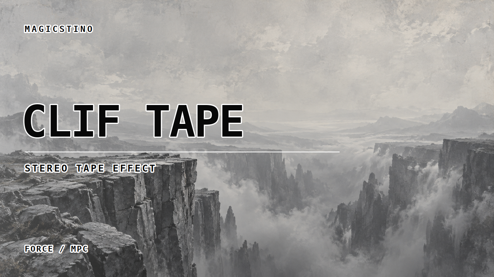
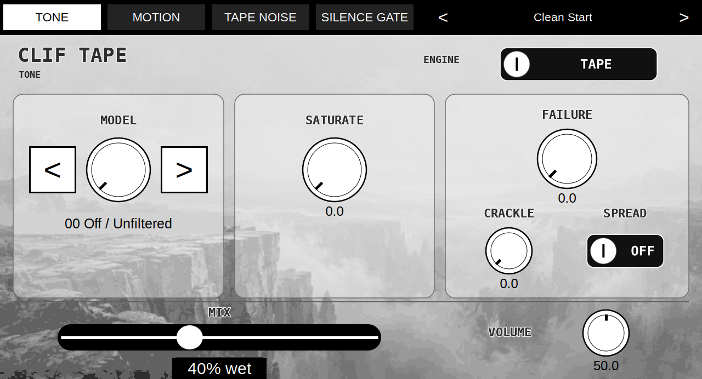
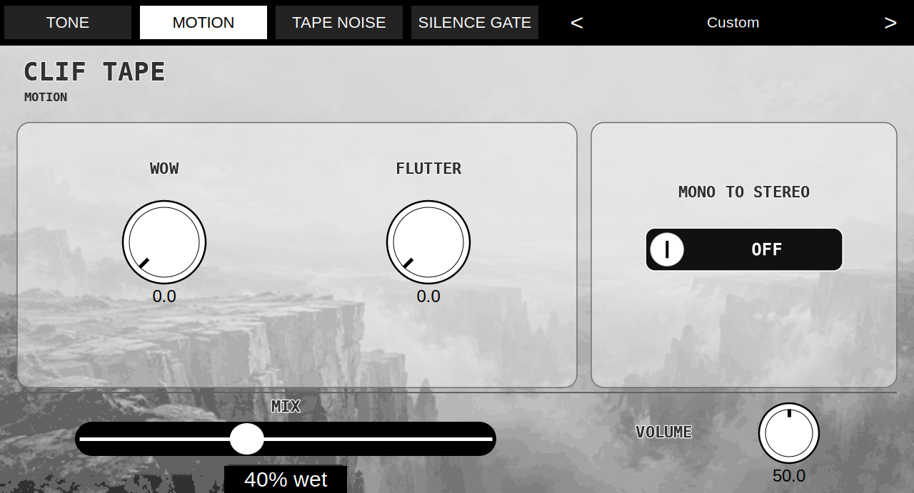
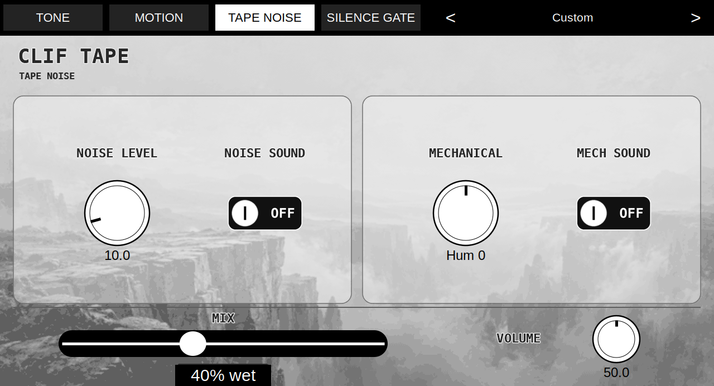
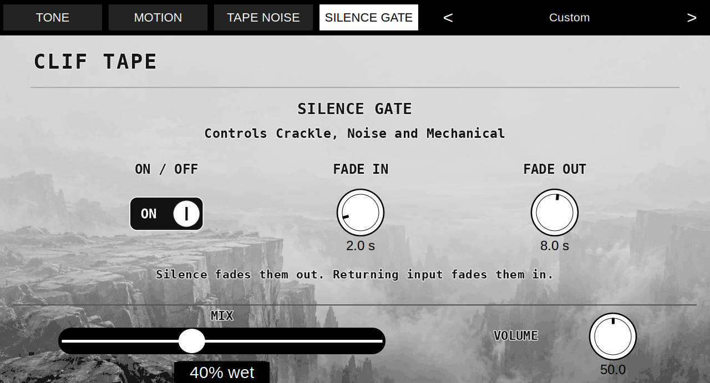

# Clif Tape

**Give a track its own character.** Clif Tape brings tape EQ curves, saturation, wandering pitch and worn-media textures to desktop DAWs and Force / MPC. Use the tone profiles to help a sound find its place in a busy mix, then blend in as much movement and texture as it needs.

## Download — ready to play

| Platform | Ready-built download | Installation |
|---|---|---|
| **Windows x64 · VST3** | [Download for Windows](https://github.com/MagicStino/Clif-Tape/releases/download/v0.2.0/Clif-Tape-0.2.0-Windows-VST3.zip) | Extract and copy the complete `.vst3` folder |
| **Mac Intel + Apple Silicon · VST3** | [Download for Mac](https://github.com/MagicStino/Clif-Tape/releases/download/v0.2.0/Clif-Tape-0.2.0-macOS-VST3.zip) | Extract and copy the `.vst3` bundle |
| **Linux x86-64 · VST3** | [Download for Linux](https://github.com/MagicStino/Clif-Tape/releases/download/v0.2.0/Clif-Tape-0.2.0-Linux-VST3.zip) | Extract into `~/.vst3` |
| **Force / MPC ARMv7** | [Download device installer](https://github.com/MagicStino/Clif-Tape/releases/download/v0.2.0/Clif-Tape-0.2.0-mpc-armv7.zip) | Install through OpenPlugin or the included installer |

No compiling needed. Desktop downloads are ZIP bundles, not installer applications. [Installation and removal](INSTALL.md) · [Full usage guide](USAGE.md) · [15 factory presets](PRESETS.md)

## One effect, four pages

The desktop VST3 keeps the cliff artwork, white knobs and four-page layout. Desktop hosts provide automation and project recall; Force / MPC adds touchscreen and Q-Link control. The previews below show the desktop interface. Device previews are in the [usage guide](USAGE.md).

### Tone

Choose from twelve tape tone profiles plus Off, add saturation and wear, or switch to Digital for low-pass, high-pass and DEGRADE. Crackle adds more events above halfway rather than louder individual clicks. Mix starts at 40% wet.

### Motion

Wow adds slow pitch wandering; Flutter adds faster movement. Both become more expressive above halfway. Combine motion with Spread on the Tone page, and Mono to Stereo when useful, to give a source width and movement.

### Tape Noise

Switch Noise and Mechanical textures on independently and set their levels. Start with a little hiss or mechanical character behind the music; neither needs to dominate the track.

### Silence Gate

Fade **Crackle, Noise and Mechanical** together when the input becomes digitally silent. The gate leaves the musical signal alone. Fade In defaults to 2 seconds and Fade Out to 8 seconds; switching the gate off disables its fade controls.

## Presets and control

Fifteen presets include Rhodes Drive, Noisy Rhodes, Worn Cassette and Velvet Keys. Preset changes update the interface. All eighteen desktop parameters support DAW automation and project recall; mapped MIDI controls are described in the [usage guide](USAGE.md).

## Compatibility

- **Windows:** Windows 10/11 x64; Microsoft Visual C++ v14 x64 runtime required.
- **Mac:** universal Intel / Apple Silicon VST3; deployment targets macOS 10.15 / 11 respectively. Ad-hoc signed, not Apple-notarized. No AU build; Logic requires AU and cannot load this VST3 directly.
- **Linux:** x86-64, glibc 2.34 or newer, with the X11/XCB, Cairo and Pango libraries listed in [INSTALL.md](INSTALL.md). Not an ARM Linux build.
- **Force / MPC:** ARMv7 community plugin hosts with OS 3.x skins; tested during development on Force 3.10.0. Gen2/aarch64 builds are not included.

Linux validation: 47 VST3 validator tests passed, plus interface control/render and active-DSP smoke checks. This is not a claim of testing every Linux DAW or distribution.

[Source and releases](https://github.com/MagicStino/Clif-Tape/releases/tag/v0.2.0) · [Developer build notes](BUILD.md)
