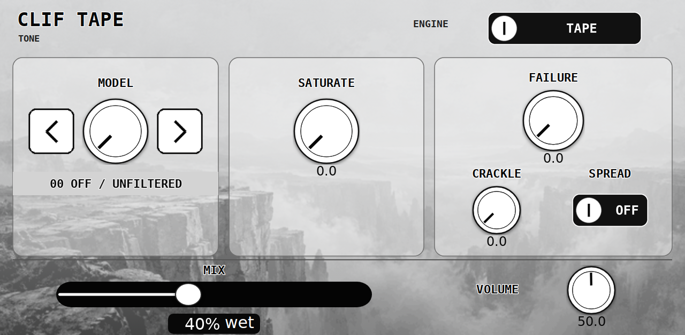
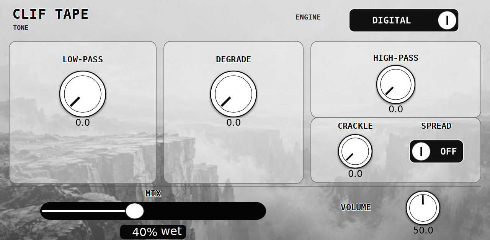
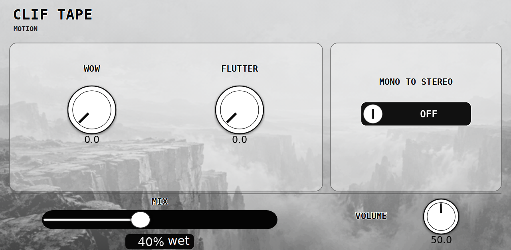
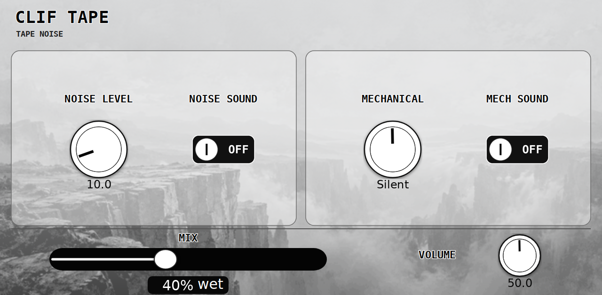
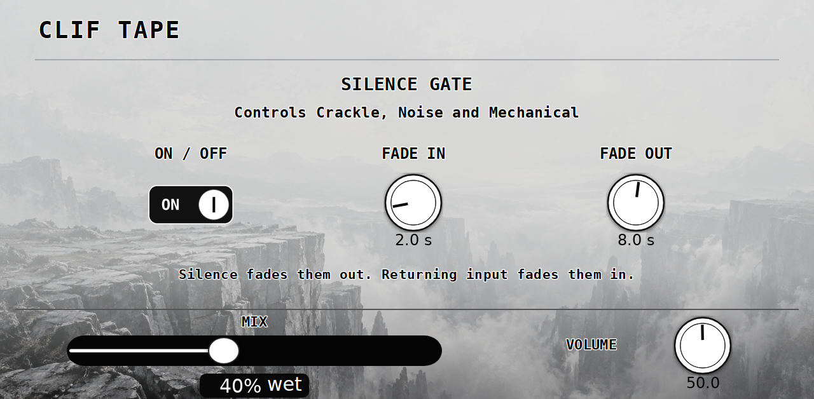

# Clif Tape usage guide

Add **Clif Tape** as an insert effect on an audio track, instrument or bus. Start with a preset and Mix at 40%; increase Mix to hear the texture more clearly. Use sustained Rhodes chords, a pad or a held note when judging pitch motion. The screen previews below are rendered from the shipped native skin.

## Tone — Tape

**Model** selects Off / unfiltered, Video 1, Video 2, Video 3, Reel, Tape, Camera, Voice 1, Voice 2, Pocket, Walk, Bright or Studio. Tap the large arrows or turn its Q-Link to step between profiles. **Saturate** adds drive before the model's tone shaping. **Failure** adds unstable wear/dropout behaviour. **Crackle** adds short worn-media transients: above 50% it adds more events rather than making each one louder. **Spread** offsets left/right motion; it is easiest to hear with Wow or Flutter turned up.

## Tone — Digital

Switch the engine to **Digital**. Model becomes **LPF**, Saturate becomes **DEGRADE**, and Failure becomes **HPF**. DEGRADE combines reduced sample rate with bandwidth filtering; turn it up for increasing damage. LPF darkens the signal and HPF removes low frequencies. The switch changes the meaning of these three controls, so their labels follow the active mode.

## Motion

**Wow** gives slower, wandering pitch movement. **Flutter** gives faster pitch shimmer. Both become more expressive above halfway. **Mono to Stereo** combines the incoming channels to mono before the stereo processing; combine it with Spread and motion to widen a mono source. It is not a stereo recording generator: the width comes from different processing on each side.

## Tape Noise

**Noise Sound** enables the Noise Level knob. The texture starts darker and becomes brighter as the level rises through approximately 7–30%. **Mech Sound** enables Mechanical: the centre is silent, with VCR-like texture on one side and Hum on the other. Both use restrained levels and can be switched independently. Clean Start has Noise off with its level ready at 10%.

## Silence Gate

This is a shared automatic volume fade for **Crackle, Noise and Mechanical**. It leaves the music signal alone. When both input channels are exactly zero, those textures fade out. Returning input fades them back in to their individual levels.

- **On / Off:** Off leaves the textures ungated and disables the fade controls while retaining their values.
- **Fade In:** 1–10 seconds; default **2 seconds**.
- **Fade Out:** 0–15 seconds; default **8 seconds**. Zero closes immediately.

The gate follows digital silence, not a level threshold: background hiss in the input or a nonzero reverb tail keeps it open. Partial fades reverse smoothly from the current level. Existing saved gate times are retained within the current ranges.

## Mix, presets and control

**Mix** blends delayed dry audio with the processed signal; 0% is dry and 100% wet. **Volume** changes the wet path. Use the host insert bypass to bypass the effect. Both paths are latency-aligned.

The fifteen factory presets are starting points, including Rhodes Drive, Noisy Rhodes, Worn Cassette, Velvet Keys and Broken Reel. Preset selection updates the displayed controls. Save your edited effect with the host/project to retain settings.

Q-Links follow the current page, including the Silence Gate switch and times. MIDI CC mappings: **14 Wow, 15 Volume, 16 Model/LPF, 17 Flutter, 18 Saturate/DEGRADE, 19 Failure/HPF, 72 Tape/Digital** (zero Tape, nonzero Digital). The mapped controls also remain host-automatable.
